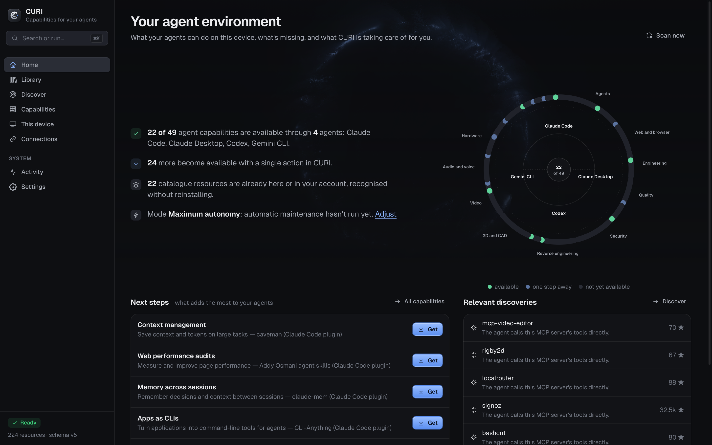
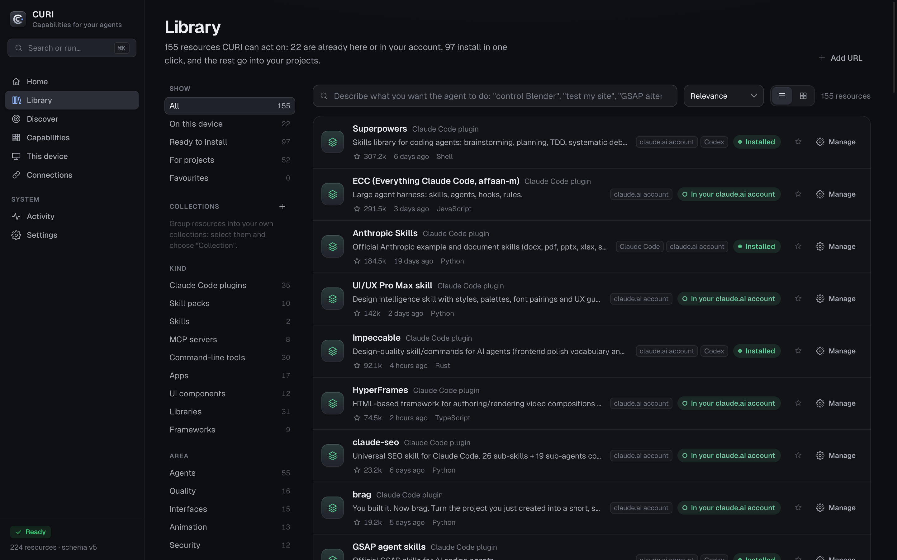
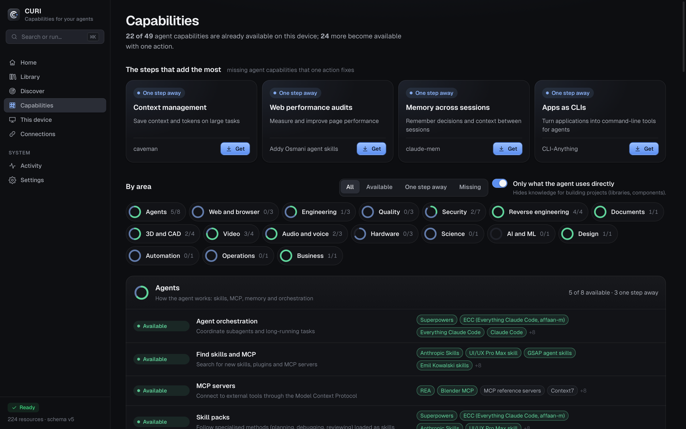
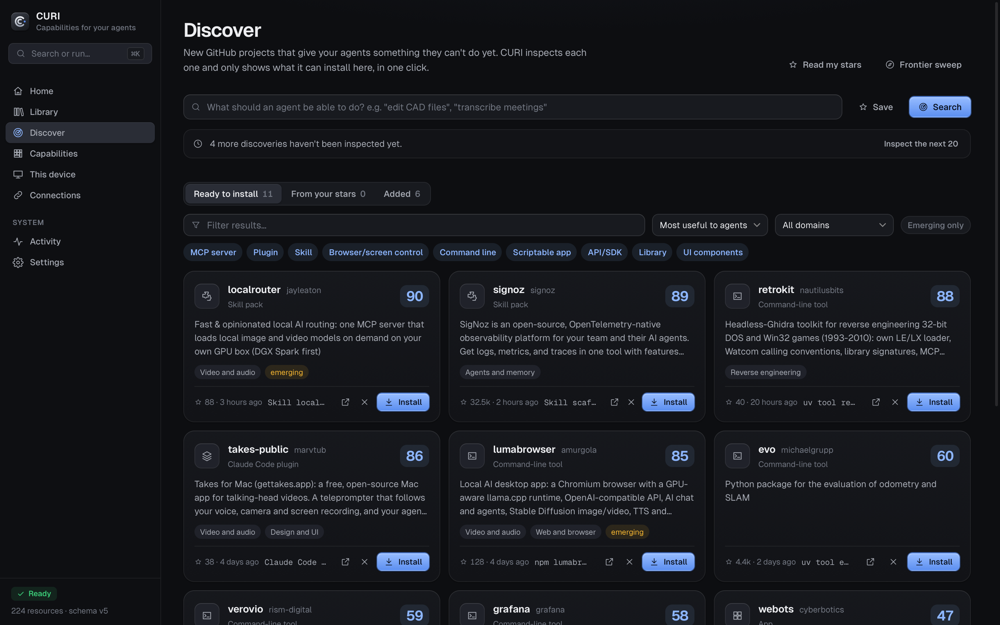

<p align="center"></p>

<p align="center">
  <b>Everything your AI agents can do, in one place.</b><br>
  See what you already have, find what's missing, and install it in one click. No terminal.
</p>

<p align="center">
  <a href="#install">Install</a> ·
  <a href="#what-it-does">What it does</a> ·
  <a href="#development">Development</a> ·
  <a href="docs/PRIVACY.md">Privacy</a> ·
  <a href="CHANGELOG.md">Changelog</a>
</p>

<p align="center"></p>

---

I use Claude Code, Codex and Claude Desktop every day, and each one had its own skills, MCP servers and plugins spread across different files. I never knew what was installed where, or whether there was something better for the job in front of me.

CURI fixes that. It reads what's already on your computer and in your claude.ai account, lines it up against a library of 220+ checked resources (skills, plugins, MCP servers, tools, apps and libraries), and does the boring part for you: installing, connecting, updating and repairing.

## What it does

**Knows what you already have.** Claude Code, Claude Desktop, your claude.ai account skills, Codex, Cursor, Gemini CLI, Windsurf and VS Code, plus your apps and what Homebrew, npm, uv and friends have installed. You never reinstall something just because CURI didn't install it.

**A library that does things.** Every resource has its real kind and the right button:
- a tool installs through your package manager;
- an MCP server gets enabled in Claude Code;
- a plugin installs, enables or disables;
- a library goes straight into one of your projects, with the package manager that project already uses (npm, pnpm, yarn, bun or uv);
- a component catalogue becomes available to your agent through the shadcn MCP server.

If CURI can't do anything with it, it doesn't show it. Favourites, collections, notes, your own kind and commands: the library bends to how you work.

<p align="center"></p>

**Capabilities, not just tools.** "Control Blender", "read PDFs", "test my site in the browser". CURI shows what your agents can already do, what's one click away, and what doesn't exist yet.

<p align="center"></p>

**Comparisons that help you decide.** What only one option offers, what it takes to get it running on your machine, dependencies, risks, upkeep and licence. No made-up scores.

**Discover, with taste.** New GitHub projects are judged by what they'd add to an agent: whether it can actually use them (MCP, skill, command line, API, scriptable app) and in which field. CURI inspects every one and only shows what it can install here, with a single **Install** button. It can also go through your GitHub stars, and saved searches can run on their own.

<p align="center"></p>

**Works on its own, within limits you set.** Three autonomy modes, with a clear table of what each one does without asking. Maintenance runs in the background: detection, checks, updates and repairs. Removals and admin actions always ask. Everything shows up in a progress window and is logged.

## Install

1. Download the `.dmg` from [Releases](../../releases).
2. Drag CURI to Applications and open it.
3. On first launch CURI installs anything missing (Node.js, Claude Code) into its own folder, shows the progress, and runs its first scan.

> Builds aren't signed with an Apple Developer ID yet. The first time, macOS asks you to confirm in *System Settings › Privacy & Security*.

**Platforms.** macOS (Apple Silicon, 13 or later) is the tested system. Windows and Linux support exists in the engine (each system's package managers, apps and credential vault) but hasn't been tested on real machines yet, and the app says so.

## Privacy

Everything stays on your computer. There's no CURI account, no CURI server and no telemetry. The interface only listens on `127.0.0.1` and needs a token. Keys live in your system's vault and never end up in config files. What gets read, and when anything leaves the machine, is in [docs/PRIVACY.md](docs/PRIVACY.md).

## Development

```bash
cd core && npm test                       # engine, operations, detection, server
node core/bin/curi.mjs app                # the interface in your browser, no build
cd desktop && npm ci && npx tauri build   # the native app (needs Rust)
node core/scripts/seed-audit.mjs          # re-inspect the starter catalogue
```

```
app/        interface (HTML, CSS and JS, no dependencies)
core/       Node engine: SQLite registry, detection, profiles, operations, policy, CLI and MCP server
desktop/    Tauri v2 shell in Rust
bridge/     the Claude skill that connects your agent to CURI
brand/      visual identity, generated from a single geometry
```

The CLI (`node core/bin/curi.mjs help`) does everything the app does, if you prefer the terminal.

[Contributing](CONTRIBUTING.md) · [Security](SECURITY.md) · [Design](docs/DESIGN.md) · [Internal contracts](docs/CONTRACTS.md)

## Licence

[MIT](LICENSE). Third-party licences are in [THIRD_PARTY_NOTICES.md](THIRD_PARTY_NOTICES.md).
