<p align="center">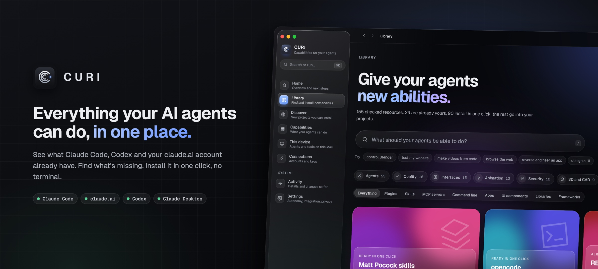</p>

<p align="center">
  
  
  
  
  
  
</p>

<p align="center">
  <a href="#install"><b>Install</b></a> &nbsp;·&nbsp;
  <a href="#a-quick-tour">Tour</a> &nbsp;·&nbsp;
  <a href="#what-it-does">What it does</a> &nbsp;·&nbsp;
  <a href="#development">Development</a> &nbsp;·&nbsp;
  <a href="docs/PRIVACY.md">Privacy</a> &nbsp;·&nbsp;
  <a href="CHANGELOG.md">Changelog</a>
</p>

<br>

I use Claude Code, Codex and Claude Desktop every day. Each one keeps its own skills, MCP servers and plugins in its own files, my claude.ai account has a few hundred more, and I never knew what was installed where, or whether something better existed for the job in front of me.

So I built CURI. It reads what's already on your computer and in your agents, lines it up against a library of 220+ checked resources, and does the boring part for you: installing, connecting, updating and repairing. Everything from the app, nothing from the terminal. It lives in your menu bar (or tray), keeps an eye on things in the background, and runs on macOS, Windows and Linux.

## A quick tour

<p align="center">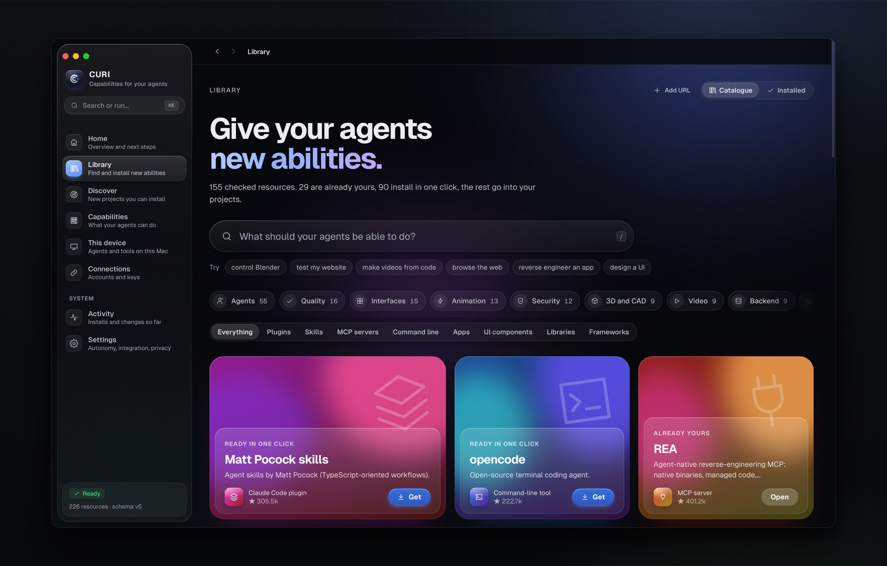</p>
<p align="center"><sub><b>The catalogue.</b> The first thing the Library shows. Ask in plain words ("control Blender", "test my site"), wander by area, or browse the shelves. Everything already yours says so and opens instead of installing again.</sub></p>

<table>
  <tr>
    <td width="50%" valign="top">
      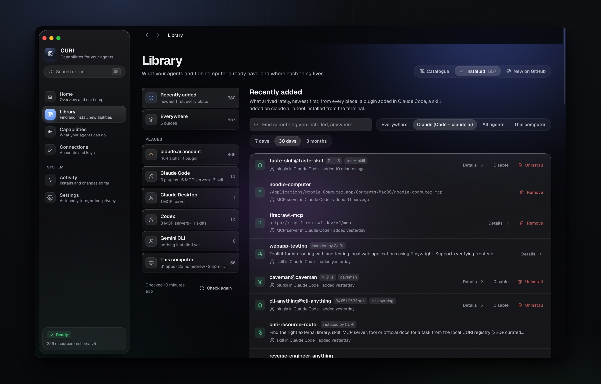
      <p><b>Recently added.</b> One timeline across Claude Code, claude.ai and the rest, so the plugin you added this morning is never lost.</p>
    </td>
    <td width="50%" valign="top">
      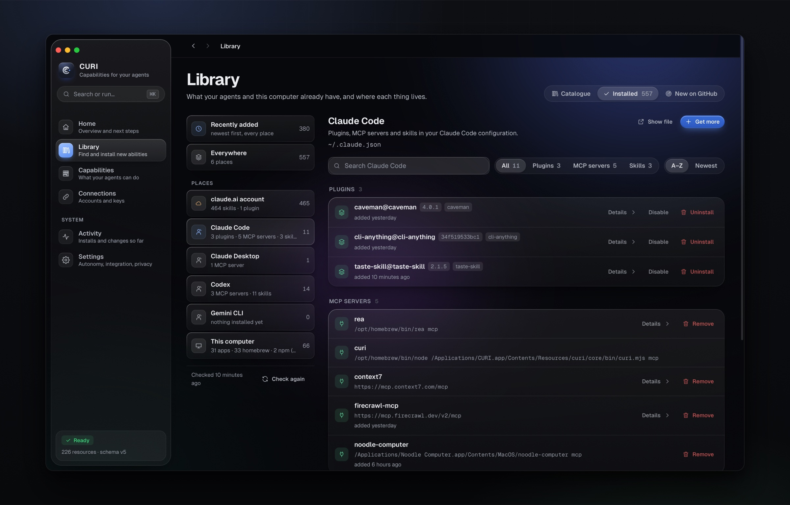
      <p><b>Installed.</b> Your claude.ai account, Claude Code, Claude Desktop, Codex and this computer, each with what it holds and the actions that make sense there.</p>
    </td>
  </tr>
  <tr>
    <td width="50%" valign="top">
      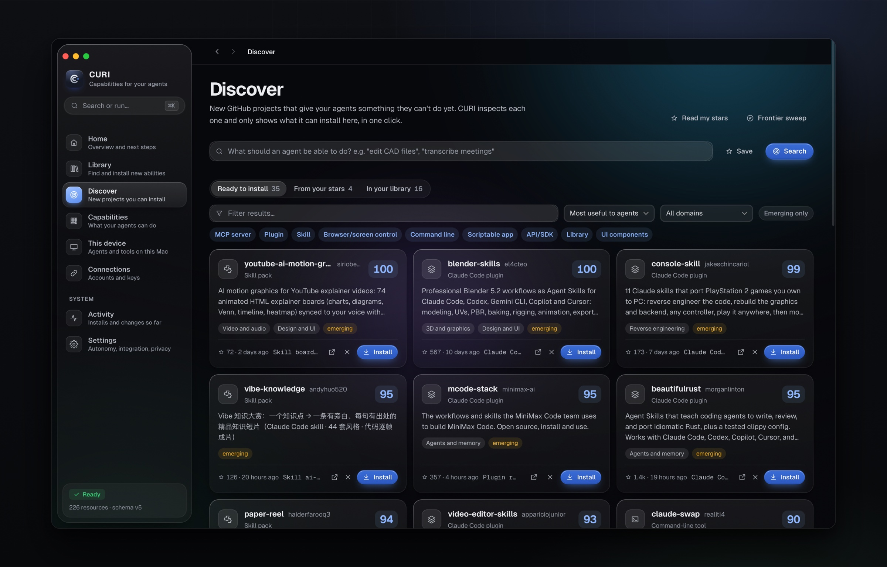
      <p><b>New on GitHub.</b> Projects CURI finds each week (and from your stars), judged by what they'd add to an agent. It inspects each one and only shows what it can install. Each has its own page with why it showed up and how it would be installed.</p>
    </td>
    <td width="50%" valign="top">
      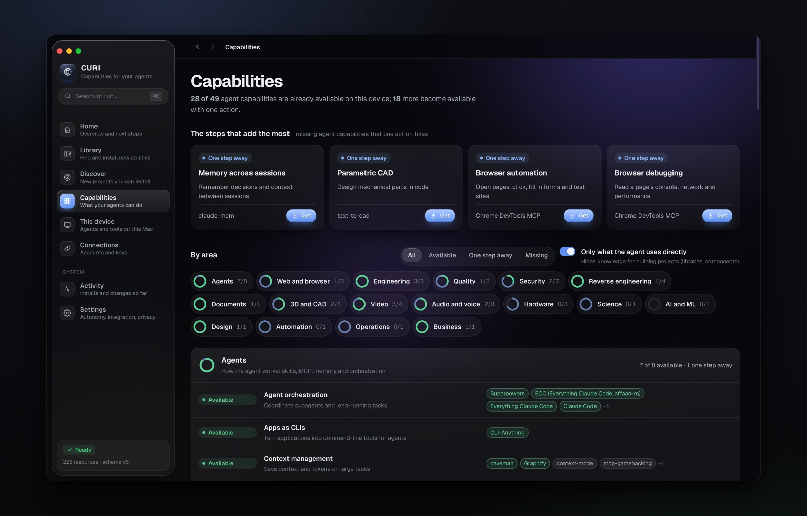
      <p><b>Capabilities.</b> What your agents can already do, what's one step away, and the steps that add the most. Every capability opens a page with everything that provides it.</p>
    </td>
  </tr>
  <tr>
    <td width="50%" valign="top">
      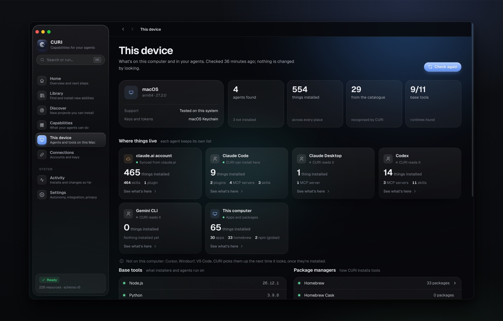
      <p><b>This computer.</b> The system, the base tools your agents run on and the package managers CURI installs through, above everything installed on it.</p>
    </td>
    <td width="50%" valign="top">
      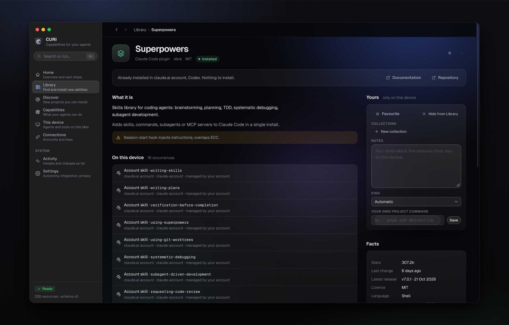
      <p><b>Every resource.</b> What it is, where you already have it, every way to get it here, and the alternatives.</p>
    </td>
  </tr>
  <tr>
    <td width="50%" valign="top">
      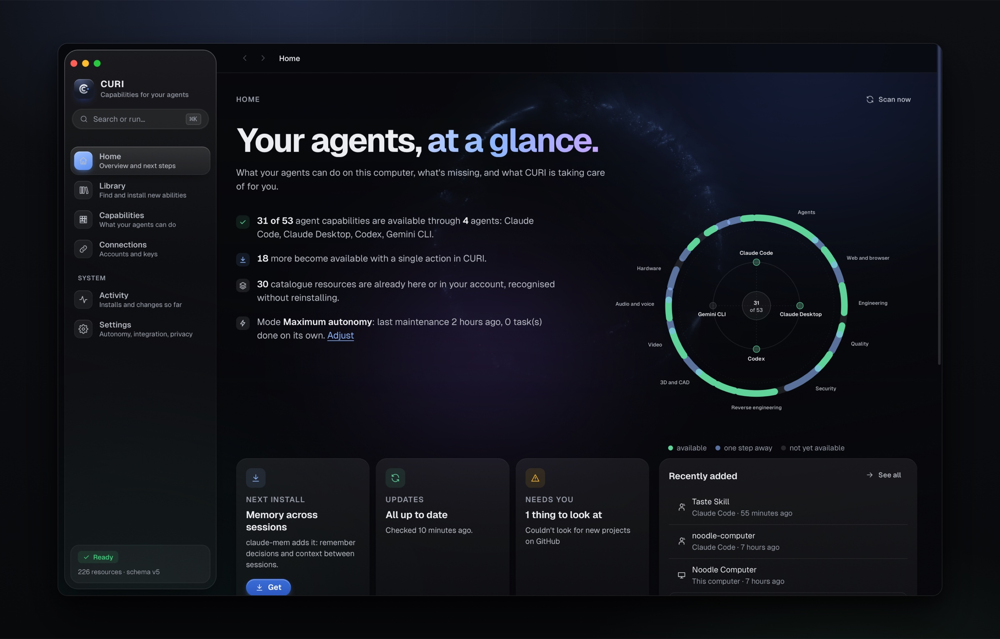
      <p><b>Home.</b> What your agents can do at a glance, the next install that adds the most, updates waiting, and anything that needs you.</p>
    </td>
    <td width="50%" valign="top">
      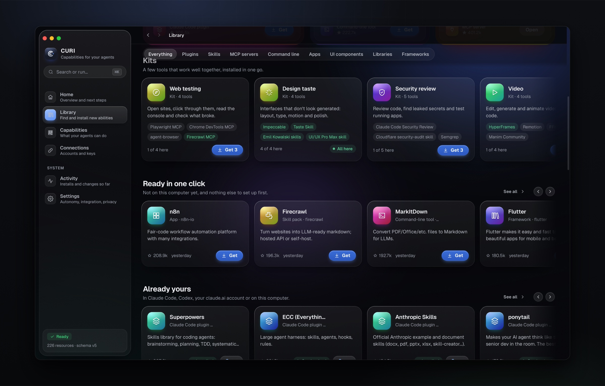
      <p><b>Kits.</b> Web testing, design taste, security review, video and more: a few tools that work well together, installed in one go.</p>
    </td>
  </tr>
</table>

## What it does

**Knows what you already have.** Claude Code, Claude Desktop, your claude.ai account, Codex, Cursor, Gemini CLI, Windsurf and VS Code, plus your apps and whatever Homebrew, npm, uv and friends installed. It never offers to install something you have; it tells you where it is and lets you manage or remove it.

**Installs for real.** Each resource has its real kind and the right button:
- a command-line tool installs through your package manager;
- an MCP server gets enabled in Claude Code;
- a plugin installs, enables or disables;
- a library goes straight into one of your projects, with the package manager that project already uses;
- a component catalogue becomes available to your agent through the shadcn MCP server.

Every install runs in a progress window that follows what the package manager is actually doing, and is checked afterwards. *Library › Installed › Updates* lists what has a newer version, and *Uninstall…* sits in every card's menu.

**Bends to how you work.** Favourites, collections, notes, your own kind and project commands, hidden items. Back and forward, ⌘K for everything, pages instead of endless scrolling. Works from the keyboard and with VoiceOver, and follows macOS when you ask for less motion, less transparency or more contrast.

**Discovers with taste.** It reads your GitHub stars and runs saved searches on its own, but only keeps projects an agent can actually use (MCP, skill, command line, API, scriptable app) and that it can install here.

**Stays on in the menu bar.** Closing the window, ⌘Q or "Quit" in the Dock don't stop CURI. It keeps an icon in the menu bar, opens at login, keeps checking in the background and sends a notification when something finishes or needs your OK. "Check Now", "Open at Login" and "Quit CURI" are right there in that menu, and "Quit CURI" there is the only thing that stops it. If it ever crashes, it comes back on its own. When a new version is out it tells you, and *Install and restart* updates it in a few seconds: signed, checked, and without the warnings a browser download gets.

**Looks after itself, within limits you set.** Three autonomy modes, with a clear table of what each one does without asking. Maintenance runs in the background. Removals and admin actions always ask, and everything ends up in an activity log with a tamper-evident audit trail.

## Install

<p align="center">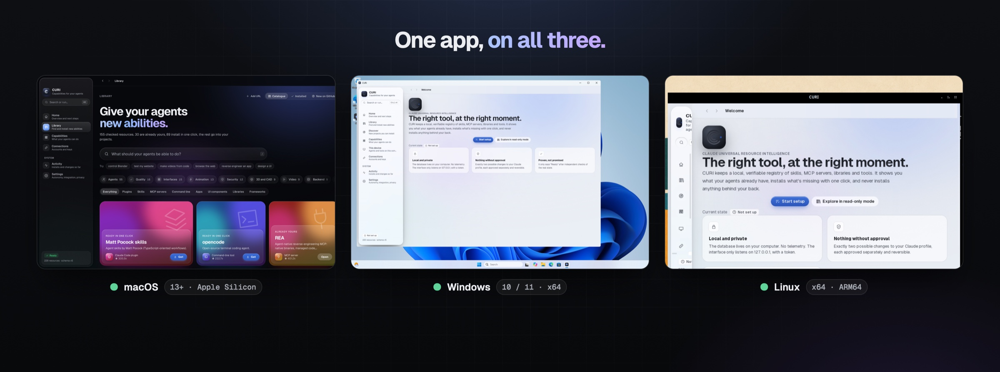</p>

Download the file for your system from **[the latest release](../../releases/latest)**:

| | Download | Then |
|---|---|---|
| **macOS** 13+ (Apple Silicon and Intel) | `CURI_x.y.z_universal.dmg` | Open it and drag CURI to Applications. |
| **Windows** 10 / 11 (x64) | `CURI_x.y.z_x64-setup.exe` | Run it. It installs for your user only, no admin rights. |
| **Ubuntu / Debian** (x64, ARM64) | `CURI_x.y.z_amd64.deb` or `_arm64.deb` | Double-click it, or `sudo apt install ./CURI_*.deb`. |
| **Other Linux** (x64) | `CURI_x.y.z_amd64.AppImage` | Make it executable and run it. |

On first launch CURI installs whatever else is missing (Node.js, Claude Code) into its own folder, shows the progress, and takes a first look at your device. Nothing is installed system-wide.

**The first time only.** CURI isn't signed by Apple or Microsoft yet, so the system asks once whether you trust it:

- **macOS** says it can't verify CURI. Open *System Settings › Privacy & Security*, scroll down and click **Open Anyway**, then confirm.
- **Windows** shows "Windows protected your PC". Click **More info › Run anyway**.
- **Linux** doesn't ask.

After that you won't see it again: CURI tells you when a new version is out and **updates itself in one click**. Updates are signed with CURI's release key and checked before they're installed.

<details>
<summary>Rather use the terminal? One command, no warning at all.</summary>

<br>

It downloads the latest release, checks it against the published SHA-256, installs it and opens CURI.

**macOS and Linux**

```bash
curl -fsSL https://raw.githubusercontent.com/kaizensx/curi/main/install.sh | sh
```

**Windows** (PowerShell)

```powershell
irm https://raw.githubusercontent.com/kaizensx/curi/main/install.ps1 | iex
```

Every release also has a `SHA256SUMS` file, if you want to check a download yourself.

</details>

**Where I've tried it.** macOS (Apple Silicon) is where I use it every day. I've also installed and run it on a clean Windows 11 (x64) and on Ubuntu 24.04 (ARM), from the first launch to installing a skill, and the engine's tests run on all three systems in CI.

## Privacy

Everything stays on your computer. There's no CURI account, no CURI server and no telemetry. The interface only listens on `127.0.0.1` and needs a token. Keys live in your system's vault and never end up in config files. What gets read, and when anything leaves the machine, is in [docs/PRIVACY.md](docs/PRIVACY.md).

## Development

```bash
cd core && npm test                       # engine, operations, detection, server
node core/bin/curi.mjs app                # the interface in your browser, no build step
cd desktop && npm ci && npx tauri build   # the native app (needs Rust)
node core/scripts/seed-audit.mjs          # re-inspect the starter catalogue
```

```
app/        interface (plain HTML, CSS and JS, no dependencies)
core/       Node engine: SQLite registry, detection, profiles, operations, policy, CLI and MCP server
desktop/    Tauri v2 shell in Rust
bridge/     the Claude skill that connects your agent to CURI
.github/    CI on macOS, Linux and Windows; release builds for all three
brand/      visual identity, generated from a single geometry; README art in brand/readme
```

The CLI (`node core/bin/curi.mjs help`) does everything the app does, if you'd rather stay in the terminal.

**Releases.** Pushing a version tag (`git tag v3.9.0 && git push origin v3.9.0`) builds macOS, Windows and Linux, signs the in-app updates, and puts everything in a draft release with checksums and the notes from the CHANGELOG. Once the draft is published, installed copies offer the update by themselves. Publishing the draft is a manual step. For a test build without a release, run the *Cross-platform build* workflow from the Actions tab.

[Contributing](CONTRIBUTING.md) · [Security](SECURITY.md) · [Design](docs/DESIGN.md) · [Internal contracts](docs/CONTRACTS.md)

## Licence

[MIT](LICENSE). Third-party licences are in [THIRD_PARTY_NOTICES.md](THIRD_PARTY_NOTICES.md).
