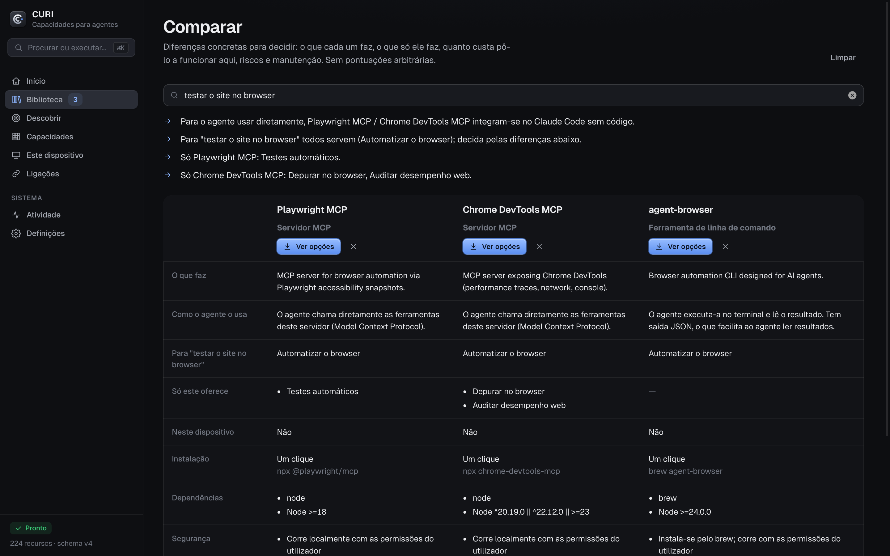

<p align="center"></p>

<p align="center">
  <b>As capacidades dos seus agentes de IA, num só sítio.</b><br>
  Veja o que já tem, encontre o que falta e instale com um clique. Sem terminal.
</p>

<p align="center">
  <a href="#instalar">Instalar</a> ·
  <a href="#o-que-faz">O que faz</a> ·
  <a href="#desenvolvimento">Desenvolvimento</a> ·
  <a href="docs/PRIVACY.md">Privacidade</a> ·
  <a href="CHANGELOG.md">Alterações</a>
</p>

<p align="center"></p>

---

Uso o Claude Code, o Codex e o Claude Desktop todos os dias, e cada um tinha as suas skills, os seus servidores MCP e os seus plugins espalhados por ficheiros diferentes. Nunca sabia ao certo o que estava instalado onde, nem se havia algo melhor para o que estava a fazer.

O CURI resolve isso. Lê o que já existe no computador e na conta claude.ai, junta tudo a uma biblioteca de mais de 220 recursos verificados (skills, plugins, servidores MCP, ferramentas, aplicações e bibliotecas), e trata da parte aborrecida: instalar, ativar, atualizar e reparar.

## O que faz

**Reconhece o que já tem.** Claude Code, Claude Desktop, as skills da sua conta claude.ai, Codex, Cursor, Gemini CLI, Windsurf e VS Code, mais as aplicações e os pacotes do Homebrew, npm, uv e companhia. Não é preciso reinstalar nada só porque não foi o CURI a instalar.

**Uma biblioteca que faz coisas.** Cada recurso tem o seu tipo real e o botão certo:
- uma ferramenta instala-se pelo gestor de pacotes;
- um servidor MCP fica ativo no Claude Code;
- um plugin instala-se, ativa-se ou desativa-se;
- uma biblioteca entra num projeto seu com o gestor que esse projeto já usa (npm, pnpm, yarn, bun ou uv);
- um catálogo de componentes fica disponível para o agente através do MCP do shadcn.

Favoritos, coleções, notas, tipo e comandos próprios: a biblioteca adapta-se a si.

<p align="center"></p>

**Capacidades, não só ferramentas.** "Controlar o Blender", "ler PDFs", "testar o site no browser". O CURI mostra o que os seus agentes já conseguem fazer, o que fica a um clique e o que ainda não existe.

**Comparações para decidir.** O que só cada opção oferece, quanto custa pô-la a funcionar no seu computador, dependências, riscos, manutenção e licença. Sem pontuações inventadas.

<p align="center"></p>

**Descobrir com critério.** Os projetos do GitHub são avaliados pelo que acrescentam a um agente: se ele os consegue usar (MCP, skill, linha de comando, API, aplicação programável) e em que área. Listas "awesome", tutoriais e ruído ficam de fora, com o motivo à vista. Também revê as suas estrelas do GitHub. As pesquisas podem ser guardadas e correr sozinhas.

<p align="center"></p>

**Trabalha sozinho, dentro dos limites que escolher.** Há três modos de autonomia, com uma tabela clara do que cada um faz sem perguntar. A manutenção corre em fundo: deteção, verificação, atualizações e reparações. Remoções e ações de administrador perguntam sempre. Tudo o que acontece aparece numa janela de progresso e fica registado.

## Instalar

1. Descarregue o `.dmg` da página de [Releases](../../releases).
2. Arraste o CURI para Aplicações e abra-o.
3. Na primeira abertura, o CURI instala o que faltar (Node.js, Claude Code) na sua própria pasta, mostra o progresso e faz a primeira deteção.

> As builds ainda não estão assinadas com um certificado Apple Developer ID. Na primeira vez, o macOS pede confirmação em *Definições do Sistema › Privacidade e Segurança*.

**Plataformas.** O macOS (Apple Silicon, 13 ou superior) é o sistema testado. O suporte a Windows e Linux já existe no motor (gestores de pacotes, aplicações e cofre de credenciais de cada sistema), mas ainda não foi testado em máquinas reais, e a app di-lo.

## Privacidade

Tudo fica no computador. Não há conta CURI, servidor CURI nem telemetria. A interface só escuta em `127.0.0.1` e exige um token. As chaves ficam no cofre do sistema e nunca passam para ficheiros de configuração. O que é lido e quando sai alguma coisa da máquina está em [docs/PRIVACY.md](docs/PRIVACY.md).

## Desenvolvimento

```bash
cd core && npm test                       # motor, operações, deteção, servidor
node core/bin/curi.mjs app                # interface no browser, sem compilar
cd desktop && npm ci && npx tauri build   # app nativa (precisa de Rust)
node core/scripts/seed-audit.mjs          # volta a inspecionar o catálogo inicial
```

```
app/        interface (HTML, CSS e JS sem dependências)
core/       motor em Node: registo SQLite, deteção, perfis, operações, política, CLI e servidor MCP
desktop/    shell Tauri v2 em Rust
bridge/     skill do Claude que liga o agente ao CURI
brand/      identidade visual, gerada a partir de uma única geometria
```

O CLI (`node core/bin/curi.mjs help`) faz o mesmo que a app, para quem prefere o terminal.

[Como contribuir](CONTRIBUTING.md) · [Segurança](SECURITY.md) · [Design](docs/DESIGN.md) · [Contratos internos](docs/CONTRACTS.md)

## Licença

[MIT](LICENSE). As licenças de terceiros estão em [THIRD_PARTY_NOTICES.md](THIRD_PARTY_NOTICES.md).
